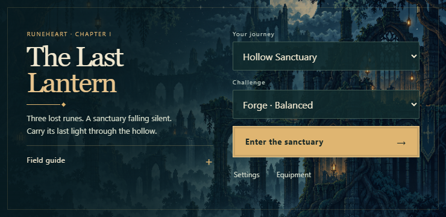

# The Last Lantern — Hollow Sanctuary

**Latest APK:** [Download Runeheart v0.5 Android test build](https://github.com/mahikshith/meglodivna/releases/download/v0.5.0-runeheart/ASH-SIGNAL-Runeheart-debug.apk) — version `0.5.0-runeheart`, code **5**, Android 7.0+. This older delivery does **not** include the Lantern rebuild below.

[Previous release and checksums](https://github.com/mahikshith/meglodivna/releases/tag/v0.5.0-runeheart) · [Previous Android validation](https://github.com/mahikshith/meglodivna/actions/runs/38470313614). The link will change only after the new APK is uploaded and verified.

The current rebuild focuses on **one chapter**: a courier carries the last lantern through a failing sanctuary, meets Mira and Orren, recovers three lost runes, and unbinds its heart. Other realm data remains for save compatibility; the game presents Hollow Sanctuary.



## The rebuild

- Original generated courier, creatures, companions, NPCs, portal and environmental art, extracted into transparent sprites with registered feet/body anchors. Source images, exact prompts and reproducible extraction scripts are included.
- Stalkers commit to close lunges; casters lob falling cinders; stone guardians brace and slam. The Regent changes from ground attacks into a fire-breathing wyrm. Warnings, damage bounds and recovery differ by attack.
- Separate horizontal/overhead/finisher arcs, thrust fire and smoke, dash afterimages, landing dust, summon arrivals, portal opening/closure and transformation effects.
- Safe opening jump practice, a more forgiving aqueduct landing, contextual objectives, and useful shield/boost/rapid/fuel rewards. Optional treasure and return portals are tested.
- A shared sanctuary theme across home, pause, settings, field guide, dialogue, equipment and HUD. Touch Pause and Gear work while another finger holds an action.

Fixed 120 Hz simulation, swept collision, variable jump height, coyote time, buffered jumping and finite thrust remain the movement foundation. The implementation plan and current-game critique explain which behavior was preserved and which was rebuilt.

## Controls

| Touch action | Function |
| --- | --- |
| Free playfield | Drag to place and move the floating joystick |
| Jump · 100px | Tap to jump; tap again in air; hold 350ms for thrust |
| Attack · 100px | Tap for sword; hold 120ms for equipped firearm |
| Dash · 92px | Commit to an evasive sword dash |
| Power · 80px | Tap to interact nearby or cast; hold 450ms for equipment |
| Gear / Pause · 48px | Open equipment or pause; held actions clear immediately |

Keyboard: A/D or arrows move, Space jumps, Shift dashes, J cuts, K fires, L/E thrusts, Q casts, F interacts, C/V/X cycle equipment, Z casts nova, Escape pauses, and R retries. Up aims upward; down+jump drops through one-way platforms. The in-game guide covers gamepad controls.

Settings preserve music, effects, reduced motion/effects and touch opacity. Android Back closes the active overlay before pausing. Existing application ID, signing certificate and progress identities are retained; clearing app data removes saves.

## Evidence and remaining work

[Detailed plan and rewritten brief](docs/HOLLOW-SANCTUARY-PLAN.md) · [Existing-game critique](docs/HOLLOW-GAMEPLAY-CRITIQUE.md) · [Level audit](docs/HOLLOW-LEVEL-AUDIT.md) · [Current validation](docs/LANTERN-VALIDATION.md) · [Asset provenance and limitations](ASSETS.md).

Legal simulations establish chapter completion and reward/portal behavior. Browser input tests establish menu and multitouch behavior. Isolated visual fixtures inspect specific attacks and effects separately. **Physical Android comfort, sustained frame pacing, thermals, audio mix and first-time human pacing remain unverified.** This is a test build, not a commercially validated release. Some animation states reuse poses; the asset report identifies them.

## Run and validate

Use Node.js 22, Phaser 3.90.0 and Vite 6.4.4.

```sh
npm ci
npm run dev
npm test
node scripts/combat-route.mjs forge soulforge
npm run build
```

Browser checks require Playwright and Chromium, a dev server on port 5173, and production preview on 4173 for replay. Set `CHROMIUM_EXECUTABLE` when using an installed Chrome binary.

```sh
node tests/hollow-ui.browser.cjs
node tests/runeheart-controls.browser.cjs
node scripts/lantern-playtest.cjs
node scripts/replay.cjs soulforge
```

Android uses JDK 17, SDK 36, minimum API 24, and an offline landscape WebView. Point `ASH_SIGNAL_DEBUG_KEYSTORE` at the persistent test certificate before building updates.

```sh
npm run android:sync
cd android
./gradlew assembleDebug lintDebug --no-daemon
```

The Android workflow validates the rebuild branch before merging. Tagged Lantern prereleases publish only after build, lint, signature, version and embedded-file checks; the publishing job downloads the uploaded APK and compares it byte for byte. [AGENTS.md](AGENTS.md) defines delivery requirements.
