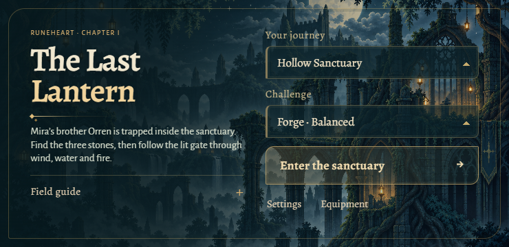

# The Last Lantern — Hollow Sanctuary

**Latest APK:** [Download The Last Lantern v0.10.0 Lantern Path Android test build](https://github.com/mahikshith/meglodivna/releases/download/v0.10.0-lantern/ASH-SIGNAL-Lantern-v0.10.0.apk) — 17 October 2026, version `0.10.0-lantern`, code **11**, Android 7.0+.

[Prerelease and checksums](https://github.com/mahikshith/meglodivna/releases/tag/v0.10.0-lantern) · [Passed Android build and upload verification](https://github.com/mahikshith/meglodivna/actions/runs/38974668399) · [Signed payload report](https://github.com/mahikshith/meglodivna/releases/download/v0.10.0-lantern/android-report.json) · [Current validation](https://github.com/mahikshith/meglodivna/releases/download/v0.10.0-lantern/validation.json). CI downloaded the uploaded APK again and matched it byte for byte; the public download also matched SHA-256 `1b79c5213428cc871efe275bce62e0c6ccc3a2c85602412213d1d48442d16cd7` before this link was updated.

The v0.10 test build follows **one clear rescue route**: Aether carries the last lantern through Hollow Sanctuary, learns that Mira's brother Orren is trapped, then enters one lit gate at a time through Wind, Water and Fire. Each crossing has four authored movement sections with visible high-landing shutters, safe relays and a guardian. An 18-second illustrated introduction establishes the courier's promise and the journey toward Lanternplate knighthood. The story is original fiction inspired by themes from the Ramayana; its characters are not presented as literal epic figures.



## The rebuild

- Original generated courier, creatures, companions, NPCs, portal and environmental art, extracted into transparent sprites with registered feet/body anchors. Source images, exact prompts and reproducible extraction scripts are included.
- Stalkers commit to close lunges; casters lob falling cinders; stone guardians brace and slam. The rebuilt Minotaur runs, leaps into charges, swings its axe and fires from its rotary gun, then becomes a cannon-bearing dragon with full-body flight poses. Warnings, damage regions and recovery differ by attack.
- Five new 1536×864 world paintings, a taller illustrated portal, a corrected courier portrait, a repainted Minotaur and full-body dragon, an eight-pose wolf, and four painted slash frames replace the most visibly mismatched art. Smooth sampling and a clear ledge rim preserve detail and the playable ground line at phone size.
- Painted muzzle flashes, cannon shells, ground impacts and directional booster exhaust share measured weapon/contact geometry. All six illustrated secondary-villain families have anatomical damage regions. Enemy shield/body circles are removed; touch controls remain visible. Awakened villains keep simulating offscreen.
- Wolf, raven, dragon and Courier Echo each have distinct locomotion, terrain awareness, target selection and attacks. Ground companions handle reachable ledges and unsupported gaps; flying companions route around solid obstacles.
- One active story gate leads through Windward Canopy, Moonlit Causeway and Ember Oath in order. Four sections per realm teach and combine changing drafts, reversing currents and moving rafts, or brittle ledges and timed vents. Landing at a high lantern opens each visible shutter; relays, catch ledges and a lower Fire recovery route keep failure readable. Automatic return portals, the optional Bellbeast, persistent souls and Soul Engine progression remain.
- The Test Armory makes all 22 weapons, armor sets and powers available for testing, with Soul Engine test upgrades. Its save is separate from earned journey progress; testing gear does not overwrite the normal unlock history.
- Authored masonry and hanging platforms, water aligned to its real boundary, and readable high-landing shutters.
- Safe opening jump practice, a more forgiving aqueduct landing, contextual objectives, and useful shield/boost/rapid/fuel rewards. Shooting preserves running or flight movement; crouching brakes horizontal drift.
- A shared sanctuary theme across home, pause, settings, field guide, dialogue, equipment and HUD. Top-edge Pause, Settings and Gear work while another finger holds an action; dialogue and notices stay at the edge. Offline Alegreya typography is bundled.

Fixed 120 Hz simulation, swept collision, variable jump height, coyote time, buffered jumping and finite thrust remain the movement foundation. The implementation plan and current-game critique explain which behavior was preserved and which was rebuilt.

## Controls

| Touch action | Function |
| --- | --- |
| Free playfield | Drag to place and move the floating joystick |
| Jump · 100px | Tap to jump; tap again in air; hold 350ms for thrust |
| Attack · 100px | Tap for sword; hold 120ms for firearm; drag this finger to aim independently |
| Boost · 92px | Tap for forward propulsion on ground or in air; hold 160ms for jet thrust |
| Power · 80px | Tap to interact nearby or cast; hold 450ms for equipment |
| Gear / Pause · 48px | Open equipment or pause; held actions clear immediately |

Keyboard: A/D or arrows move, Space jumps, Shift boosts, J cuts, K fires, L/E thrusts, Q casts, F interacts, C/V/X cycle equipment, Z casts nova, Escape pauses, and R retries. Up aims upward; down crouches on the ground and down+jump drops through one-way platforms. On touch, keep moving with the joystick while dragging the held Attack button to aim downward or upward without steering flight. A gamepad's right stick provides independent aim; the in-game guide covers its other controls. Boost replaces the separate evasive sword dash and consumes booster fuel.

Settings preserve music, effects, reduced motion/effects and touch opacity. Android Back closes the active overlay before pausing. Existing application ID, signing certificate and progress identities are retained; clearing app data removes saves.

## Evidence and remaining work

[Current correction plan and platformer references](docs/PLAYTEST-CORRECTION-PLAN.md) · [Story and crossing notes](docs/RAMAYANA-STORY-AND-CROSSINGS.md) · [Current validation](artifacts/playtest-correction/validation.json) · [Asset provenance and limitations](ASSETS.md) · [Persistent art-production memory](docs/ASSET-PRODUCTION-MEMORY.md).

The v0.10 candidate passed 237 unit tests, nine legal fixed-step campaigns through the final transformed boss, 58 isolated phone-size visual fixtures, nine real-input control checks, four story browser checks, a production preview smoke test and five painted-panorama seam checks. The [signed APK report](https://github.com/mahikshith/meglodivna/releases/download/v0.10.0-lantern/android-report.json) verifies version code 11, the persistent `com.meglodivna.ashsignal` application ID and signing certificate, and all 85 embedded web files. The uploaded public APK matched the report and checksum. Automated campaign times are 4:54–6:01; they do **not** establish the ten-minute first-human-play target. Physical-device comfort, sustained performance and first-time human pacing remain unverified.

The published v0.8 illustrated revision passed 189 unit tests and nine legal simulation campaigns, including the optional giant/reward/return route, plus its browser and visual checks. [v0.8 validation](artifacts/character-revision/validation.json) and [v0.8 revision scope](docs/ILLUSTRATED-RELEASE.md) describe that historical delivery. The [v0.9 integrated validation](artifacts/epic-rebuild/validation.json) records 231 passing tests, nine complete legal routes in 10:52 to 11:43, 53 visual fixtures and eight actual-input scenarios for the previous layout. This is a test build, not a commercially validated release. Some animation states reuse poses; the [asset report](ASSETS.md) identifies them.

## Run and validate

Use Node.js 22, Phaser 3.90.0 and Vite 6.4.4.

```sh
npm ci
npm run dev
npm test
node scripts/combat-route.mjs forge soulforge --correction
node scripts/combat-route.mjs forge soulforge --bellbeast --correction
npm run build
```

Browser checks require Playwright and Chromium, a dev server on port 5173, and production preview on 4173 for the production smoke test. Set `CHROMIUM_EXECUTABLE` when using an installed Chrome binary.

```sh
npm run test:browser
npm run test:visual
npm run preview -- --port 4173
# In a separate terminal while preview runs:
npm run test:production
node scripts/check-parallax-seam.cjs
node scripts/verify-correction-evidence.mjs
```

Android uses JDK 17, SDK 36, minimum API 24, and an offline landscape WebView. Point `ASH_SIGNAL_DEBUG_KEYSTORE` at the persistent test certificate before building updates.

```sh
npm run android:sync
cd android
./gradlew assembleDebug lintDebug --no-daemon
```

The Android workflow validates the rebuild branch before merging. Tagged Lantern prereleases publish only after build, lint, signature, version and embedded-file checks; the publishing job downloads the uploaded APK and compares it byte for byte. [AGENTS.md](AGENTS.md) defines delivery requirements.
