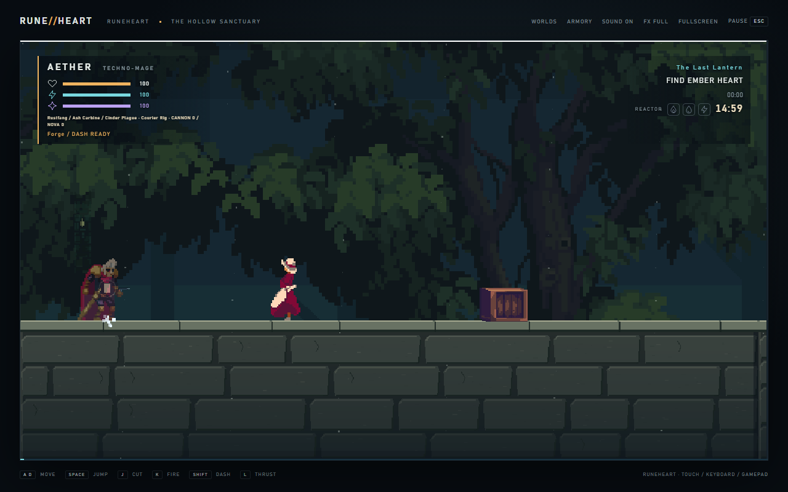

# RUNE//HEART — ASH SIGNAL v0.5

**Latest APK:** [Download Runeheart v0.5 Android test build](https://github.com/mahikshith/meglodivna/releases/download/v0.5.0-runeheart/ASH-SIGNAL-Runeheart-debug.apk) — 14 October 2026, version `0.5.0-runeheart`, code **5**, Android 7.0+.

[Release and checksums](https://github.com/mahikshith/meglodivna/releases/tag/v0.5.0-runeheart) · [Passed Android CI](https://github.com/mahikshith/meglodivna/actions/runs/38470313614) · [Action screenshots](artifacts/runeheart/actions/contact-sheet.png). Latest APK links are updated after upload verification; see [AGENTS.md](AGENTS.md).

Runeheart rebuilds the game around three rune stones, guardian seals, vertical chambers and optional treasure vaults. The courier enters a sanctuary that burns people into light; recover its stones and sever the engine. The APK above is the verified CI build of this rebuild.



## What changed

- Continuous solid floors with thick landing caps, shaded foundations, irregular stone faces and distinct platform undersides. Full-height backgrounds remain present during jetpack ascent; skyline layers sit behind the playable ground.
- A full-proportion animated swordfighter, true run/jump/sword frames, a quadruped wolf and animated NPCs. Selected CC0 Gothicvania artwork by Ansimuz joins the retained robots, dragon and items from the supplied references. Sources, licenses and limitations: [ASSETS.md](ASSETS.md).
- Enemies patrol, chase, retreat, jump obstacles and telegraph directional attacks. Sword combos buffer repeated presses, hold their attack direction and stagger smaller enemies. Dash cuts through enemies, while heavy guardian attacks require evasion.
- A camera that follows vertical travel, looks ahead and widens around nearby threats. No attack-triggered zoom-in that hides the route.
- Large, spaced touch controls in a curved bottom layout, a floating joystick, visible held-mode indicators and adjustable opacity. Gameplay keeps a dedicated region above the action buttons.

## Worlds and objectives

| Realm | Features |
| --- | --- |
| Runeheart · Hollow Sanctuary | Broken roots, bell ascent, aqueduct, crypt, rune vault and guardian chain |
| Drowned Choir · Sluice Kingdom | Currents, raft crossings and undertow guardians |
| Cinder Coven · Furnace Below | Steamworks, crumbling spans and a furnace valve that weakens a guardian |
| Storm Archive · Broken Circuit | Conduits, vertical maintenance lift and overload attacks |
| Glass Necropolis · False Moon | Mirror summons, crypts and Ysra's blood-for-dragon pact |

Find Ember Heart, Tide Glass and Storm Seal to open the final gate. Stones also strengthen finishers, grant a shield and reward dash kills with fuel. Optional elevated vaults contain equipment and return portals. Three guardians protect each realm. The Regent transforms into a flying rocket wyrm.

Five realms share room archetypes and systems but change their order, elevation and special mechanics. Optimized legal test routes take about **97–177 simulated seconds**, depending on realm/difficulty. A five-minute minimum and first-time human completion time are **not established**. See [LEVEL.md](LEVEL.md) for exact scope.

Choose Ember, Forge, Inferno or Extinction. Difficulty changes damage, health, cadence, recovery, resources and deadline. The Forge deadline is fifteen minutes; dialogue and armory menus pause it.

## Controls

Touch any free gameplay area to place the analogue joystick under your finger. Its origin stays fixed during that drag; release stops movement and the stick disappears after eight seconds.

| Touch action | Function |
| --- | --- |
| Jump · 100px | Press to jump; press again in air for the second jump; hold 350ms for jet thrust |
| Attack · 100px | Press for immediate sword cut; hold 120ms to fire the equipped gun |
| Dash · 92px | Sword dash; cannot repel heavy attacks |
| Power · 80px | Tap to interact nearby or cast; hold 450ms for the paused power/equipment palette |
| Gear / Pause · 48px | Direct menu access; opacity preference in paused settings |

Targets have at least eight CSS pixels between them. Buttons use icons and a curved arrangement in a reserved 164px landscape gutter. Independent fingers can steer, jump and attack together. Browser tests do not establish physical thumb comfort or device latency; see [control evidence](docs/RUNEHEART-CONTROLS.md).

Keyboard: **A/D or arrows** move, **Space** jump, **Shift** dash, **J** cut, **K** fire, **L/E** jet, **Q** spell, **F** interact, **C/V/X** cycle gun/sword/spell, **Z** nova, **Escape** pause and **R** retry. Up aims upward; down+jump drops through a one-way platform. Gamepad face/shoulder inputs are documented in [INTERFACES.md](INTERFACES.md). Android Back closes an open palette before pausing.

## Equipment and progression

Three swords, five guns, three armors, nine spells and six relics retain their catalog identities. Carbine, scattergun, rail, launcher and charged cannon have distinct fire. Cinder burns, Siphon drains, Skybreaker staggers, Veil conceals, Stillgrave slows and Eclipse consumes a finite charge. Echo, Wolf and Wyrm call temporary allies through summoning effects. Shields, jet boosts, overload pickups, destructible caches and explosive barrels affect combat.

Discoveries and equipment persist. Encounter state is separate per realm. The new layout migrates older checkpoint positions while retaining discovered equipment. Retry returns to the relay and preserves spent charges and claims. Clearing app data removes saves.

## Run and validate

Use Node.js22, Phaser3.90.0 and Vite6.4.4.

```sh
npm ci
npm run dev
npm test
npm run test:game -- forge soulforge
npm run test:deep
npm run build
```

Browser tests require a running dev server on port5173, production preview on4173 where specified, Playwright and Chromium. `CHROMIUM_EXECUTABLE` may point to an installed browser. See [VALIDATION.md](VALIDATION.md) for exact commands, scope and fresh reports.

Android: JDK17, SDK36, minAPI24, landscape WebView with bundled offline assets. Keep `ASH_SIGNAL_DEBUG_KEYSTORE` pointed at the persistent test key so v0.3+ installations can update without clearing saves.

```sh
npm run android:sync
cd android
./gradlew assembleDebug lintDebug --no-daemon
```

The Android workflow builds on `main`, `Revamp`, pull requests and manual dispatch. Its APK artifact is **ASH-SIGNAL-Runeheart-debug-APK**. Fork pull requests cannot access the signing secret. [REBUILD.md](REBUILD.md) records the task breakdown and research; [VALIDATION.md](VALIDATION.md) distinguishes simulation, browser and Android build evidence. This is a debug test build, not a commercially validated release.
