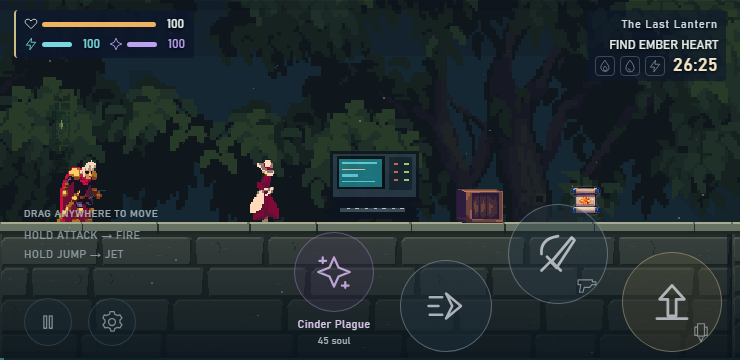
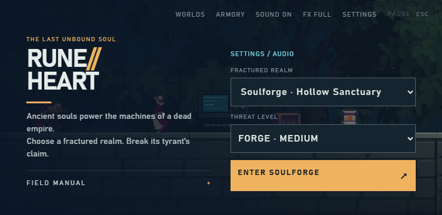
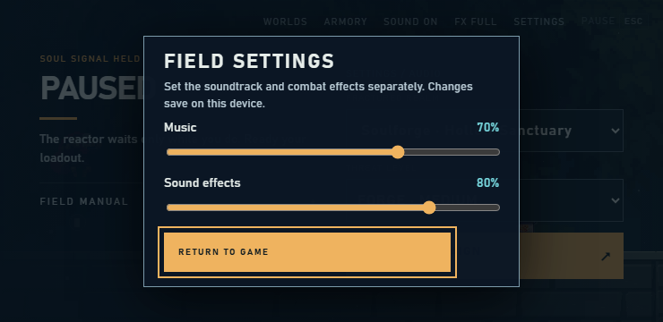

# Hollow Sanctuary UI critique

The current interface is usable enough to test the game, but it does not establish a coherent place or clearly explain its most unusual controls. Rebuild one chapter around the lantern sanctuary, keeping the working control geometry and pause behavior as constraints.

Evidence: the captured 740 × 360 browser views below, `index.html`, `src/style.css`, `src/ui.js`, and the menu/settings handlers in `src/main.js`. These captures establish appearance at one size; they do not establish physical-device comfort, performance, animation quality, or willingness to pay.

## Findings in priority order

| Priority | Observed evidence | Implication and rebuild check |
| --- | --- | --- |
| 1 | Home says “Runeheart,” “fractured realm,” and “Soulforge”; gameplay says “The Last Lantern”; paused copy mentions a reactor. A forest surrounds a bright computer terminal. | The world has several competing identities. Use one chapter premise and visual vocabulary in home, HUD, dialogue, gear, pause, death, and completion. Remove old realm promises from the player-facing launch. Check every state, including text generated by `main.js`. |
| 1 | Settings says “Return to game,” but its handler only closes the dialog; a paused run remains paused. Chapter and difficulty selectors remain visible behind the paused overlay. | Navigation promises are inaccurate. Label the settings action “Back to pause” when applicable and make Resume the primary pause action. Hide new-run selectors during pause. Verify opening, Escape/Android back, closing, and resuming preserve simulation time and clear held inputs. |
| 1 | Gameplay has four large action faces but only the power has a persistent name. The “hold” instructions are small grey text over the character/ground boundary. Attack and Jump show a tiny secondary gun/jet symbol. | The unusual tap/hold distinction may be missed; that is an inference to test with first-time players. Keep the established 100px Attack/Jump and 92px Dash targets, and ≥8px gaps. Introduce tap versus hold before the first threat; confirm the actual icon state changes during holds. Do not solve this by shrinking buttons. |
| 2 | The lower-right action cluster sits over the foreground blocks; the left helper text crosses the walking surface. The upper HUD is already compact and leaves the middle open. | Preserve the compact two-cluster HUD. Keep text away from silhouettes and ground edges, and stage hazards/rewards where the player can read them above the touch cluster. Validate camera framing together with the UI. A screenshot cannot establish whether fingers obscure a critical enemy. |
| 2 | Home has a six-item top navigation, a second Settings entry, two selects, a launch button, and a manual link. Much of the screen is spent on selectors before the player sees the chapter's purpose. | For a single chapter, foreground its rescue objective and one launch action. Keep difficulty as a small explicit choice and move secondary controls into pause/settings. Ensure primary launch remains visible without scrolling at 640 × 360 and 740 × 360. |
| 2 | Menu, settings, HUD and touch faces use conventional flat navy rectangles/circles, a technical sans typeface, and cyan/purple/amber accents. They share colors but little material character with the forest. | Use a restrained sanctuary material system: dark teal stone, bone text, warm amber highlights, carved corner details. Serif display titles can distinguish story surfaces while a plain readable face handles controls/body text. Judge the result beside actual world art, not as a standalone menu. |
| 2 | In the gameplay capture, the apparent player and nearby character have similarly prominent warm silhouettes; the crate, terminal and small bright pickup do not communicate their roles through the UI. | Whether a new player recognizes friendly characters and usable objects is unproven. Add contextual interaction wording tied to the nearby object, readable reward feedback, and consistent item icon treatment. Verify prompts appear at the same range that the action can succeed. |
| 3 | The settings panel fits the screenshot and its slider values are visible. Opacity lives in the gear dialog, while reduced effects and sound toggles live in the top navigation. | Preserve the working volume controls and persistence. Consolidate presentation controls in settings, retaining existing IDs/callbacks or deliberately updating every caller and test. Verify reduced effects changes optional effects without hiding attack tells. |
| 3 | The stylesheet contains repeated definitions and multiple competing mobile overrides. The manual is a long block of mixed touch, keyboard and gamepad instructions. | Replace the CSS cascade with one responsive system. Group the manual by input type and keep it closable while scrolling. Check focus order, modal boundaries, contrast and overflow in actual rendered states. |

## Design proposal based on the captures

Home should show a quiet view of the sanctuary with a dark readable margin, the title **The Last Lantern**, a short rescue premise, **Enter the sanctuary**, and a small difficulty choice. The chapter is fixed. Secondary links are **Field guide** and **Settings**. Preserve Runeheart only as a subordinate project identity if needed, rather than a competing title.

The pause view should feel like the same place held still: **Rest at the lantern**, **Resume**, **Equipment**, **Field guide**, and **Settings**. Death should explain the checkpoint return and retained discoveries; chapter completion should name what the player restored. No screen should advertise a campaign beyond this playable chapter.

Menus and dialogue should resemble worn dark stone with narrow amber inscriptions. Use decoration at panel edges and title separators, leaving body text and focus indicators plain. Gear uses the same surface, explicit discovered/equipped states, and short readable effect descriptions. Avoid styling locked equipment so faintly that its explanation disappears.

During play, retain health/fuel/resonance at upper left and the immediate objective plus recovered runes at upper right. Keep the center clear. Touch faces retain their tested dimensions and positions, but use matching material colors and strong pressed/held/cooling states. The field guide teaches **tap Attack to slash; hold to fire**, **tap Jump to leap; hold to thrust**, **tap the rune to cast or interact; hold for equipment** with the same icons used in play.

## Rebuild acceptance checks

- Capture home, active play, pause, settings, equipment, field guide, dialogue, death and completion at 740 × 360; also check 640 × 360, 844 × 480, portrait, and desktop for overflow and reachable actions.
- Retain ≥48px secondary targets, 100px Attack/Jump, 92px Dash, ≥8px target separation, safe-area clearance, and independent simultaneous movement/action input.
- Open every overlay during movement and a held attack; confirm the run pauses where intended, no action leaks through, and closing restores the correct previous surface and keyboard focus.
- Verify audio/opacity/effects settings persist, slider values match the result, and all close labels accurately describe their destination.
- Walk the chapter using the actual interactions to check contextual prompts, collection feedback, and guide accuracy. Keep isolated control fixtures distinct from legal campaign play.
- Ask a first-time physical-device player to move, slash, shoot, jump, thrust, interact, change gear and resume without verbal coaching. Record missed actions and occlusion. Until this is done, describe mobile comfort as unverified.

No implementation changes were made for this critique. Commercial appeal remains a user-testing question; visual consistency alone cannot establish it.
